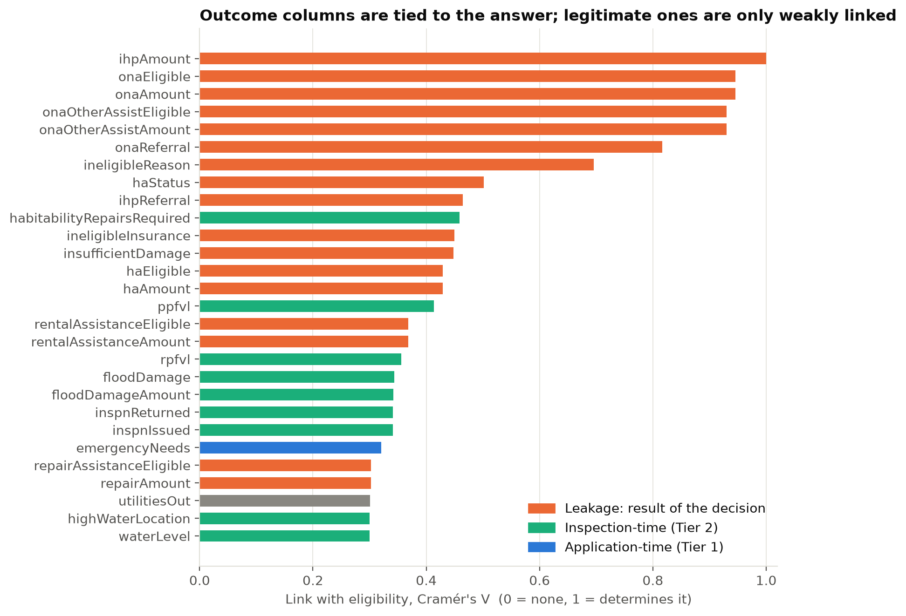
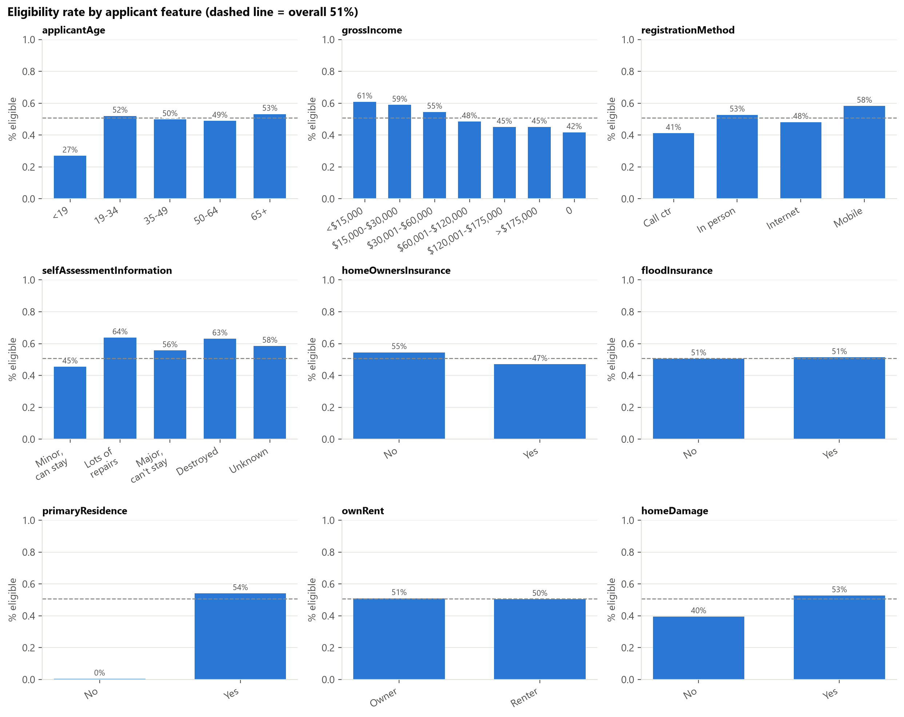

# 3. Comprehensive Data Analysis

<!-- Owners: Anthony (complete EDA with visualizations), Daniel (preprocessing details, feature engineering documentation, final dataset characteristics). 3-4 pages. -->

<!-- ===== Anthony's part: 3.1-3.6 ===== -->
<!-- AI wording, Nov 23-26: 3.1-3.5 condensed from Milestone 1 Section 3 (which Anthony co-wrote); 3.6 written from Anthony's answers, and "Why income" rewritten from his draft. Simplified at his request and reviewed by him, Nov 26. Logged in docs/ai_usage/anthony.md. -->

The full analysis is in `notebooks/eda/01_initial_eda.ipynb`, and column definitions are in `docs/data_dictionary.md`. Milestone 1 covered this analysis in detail. This section sums it up, then checks each finding against what the trained models showed (Section 3.6).

### 3.1 Data source and scope

The data is FEMA's *Individuals and Households Program – Valid Registrations (v2)*, a public dataset, filtered to Hurricane Ian (DR-4673) in Lee County, FL. We downloaded it with `src/data/fetch_fema.py`. It has **194,482 rows and 100 columns**: one row per household's application, dated 2022-09-27 to 2023-01-12. FEMA says it is raw data that can contain human errors, and it holds valid registrations only.

### 3.2 Target

`ihpEligible` is True when FEMA gave the household housing aid, other-needs aid, or both. The two classes are almost even: 98,648 eligible (50.7%) and 95,834 not (49.3%) (Figure D.1). Our stratified split keeps that 50.7% in the training, validation, and test sets, so we didn't need to resample.

### 3.3 Feature tiers and leakage

Every column has one role, set in `src/utils/columns.py`:

- **Tier 1:** 26 columns known at registration. They become 25 model features: `appliedDate` turns into `daysSinceLandfall`, and `damagedCity` is dropped.
- **Tier 2:** Tier 1 plus 14 columns learned at inspection, 39 features in all.
- **Leakage:** 43 columns that are results of FEMA's decision. Never used.
- **ID or constant:** 15 columns with nothing to learn from.
- **Under review:** `utilitiesOut`, held out for now. It is blank on 2.7% of rows, and 99.9% of those were approved.

To find leakage, we measured how strongly each column is linked to the target (Cramér's V, Figure 3.1). Decision results score near 1 (`ihpAmount` 1.00, `onaEligible` 0.95, `ineligibleReason` 0.70). The best legitimate column scores only 0.46. We moved `currentLocation` to Tier 2 because some of its values, like "FEMA-provided unit", are themselves a result of aid.

*Figure 3.1. Each column's link with eligibility (Cramér's V). Leakage columns sit at the top.*

### 3.4 Distributions and relationships with the target

Most applicants were 50 or older (57%), lived alone or with one other person, owned their home (64%), and applied online or by app (77%) (Figure D.2). Damage amounts are very lopsided: FEMA-verified real-property loss (`rpfvl`) is $0 for about 83% of applicants. ZIP code has about 560 different values.

Some features change the approval rate a lot (Figure 3.2):

| Feature | Approval rate |
|---|---|
| Not the primary residence | about 0.4% |
| Reported emergency needs vs. not | 66% vs. 34% |
| Homeowners insurance vs. none | 47% vs. 55% |
| Income under $15k vs. above $175k | 61% vs. 45% ($0 income: 42%) |
| Applied in week 1 vs. week 5 after landfall | 65% vs. 19% (Figure D.4) |
| Tier 2: inspection completed vs. not | 73% vs. 38% |

No single numeric feature is strongly linked to the target; the strongest correlation is about 0.36 (Figure D.5). Some pairs are near-copies of each other: inspection issued vs. completed (1.00), and verified home damage vs. flood damage amount (0.97) (Figure D.6).

*Figure 3.2. Eligibility rate within each category of key features.*

### 3.5 Missing values and data quality

Nineteen columns have blanks, and six usable ones are more than 10% blank (Figure D.7). Most blanks mean something; they are not random. `renterDamageLevel` is 96% blank because it only applies to renters. `foodNeed` and `shelterNeed` are almost always "yes" when filled in, so a blank means "not reported".

The quality checks found:

- 14 constant columns
- 407 exact duplicate rows (0.21%), kept because they are likely different households with the same answers
- 6,357 rows (3.3%) with a census block outside Lee County
- hand-typed city names
- one impossible flood depth (960 inches)

Section 3.7 explains how each was handled.

### 3.6 What the models confirmed

Milestone 1's analysis made predictions about which signals would matter. The trained models (Section 4) and the permutation importance in Section 5.2 let us check them.

| Milestone 1 finding | What the Milestone 2 model showed | Verdict |
|---|---|---|
| Emergency needs: 66% vs. 34% approval | Most important input in both tiers (AUC drop 0.148 Tier 1, 0.116 Tier 2) | Confirmed |
| Non-primary residences almost never approved | 2nd most important Tier 1 input (0.086) | Confirmed |
| Insurance lowers approval | 3rd most important Tier 1 input (0.055) | Confirmed |
| Approval falls with weeks since landfall | `daysSinceLandfall` is 5th in Tier 1 (0.039); scoring later applications lowers AUC by 0.034 (Section 5.5) | Confirmed, with a limitation |
| No single strong column; the model needs several together | Gradient boosting, which combines many inputs, was chosen; even the top input explains only part of the AUC | Confirmed |
| Income gap of 16 points | `grossIncome` barely matters to the model (AUC drop under 0.005) | **Not confirmed** |
| `currentLocation` partly reflects aid already given | 2nd most important Tier 2 input (0.065) | A risk to watch (Section 5.5) |

**Why income didn't hold up.** The income gap in the EDA is real. But higher-income households are also more likely to have insurance and to own their home, and the model already knows both. So income tells it almost nothing new: it is **redundant**. A column can look strong on its own and still be redundant next to others. Income still matters for fairness, though: Section 5.3 checks whether the model's mistakes differ by income group.

**What this means.** Most of the EDA's predictions held up. That suggests the model learned the same patterns a careful analyst would see, not flukes in the training data. The two exceptions point at real limits: columns that repeat each other (income), and columns that may carry part of FEMA's decision (`currentLocation`).

<!-- ===== Daniel's part (3.7 onward): preprocessing, feature engineering, final dataset ===== -->
