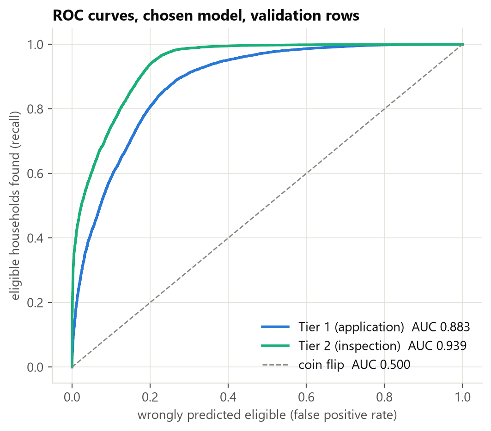
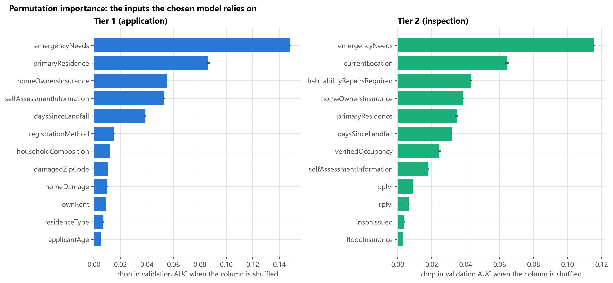
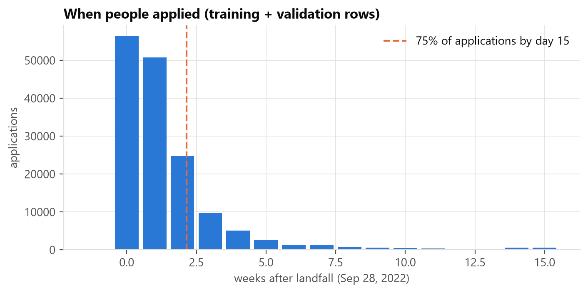

# 5. Results and Evaluation

<!-- Owners: Anthony (performance metrics for all models, model interpretation, limitations and assumptions), Nandor (business value assessment, fairness). 3-4 pages. -->

<!-- ===== Anthony's part goes here: 5.1 performance metrics, 5.2 model interpretation, 5.5 limitations and assumptions ===== -->

## 5.1 Performance metrics

<!-- Reworded by Anthony, Nov 25, from an AI draft. Table 5.1 from notebooks/modeling/01_model_comparison.ipynb. -->

We used 10 algorithms on both tiers and compared them on the validation set, along with two simple baselines. Gradient boosting scored highest on both, with a ROC-AUC of 0.880 at Tier 1 (registration) and 0.938 at Tier 2 (after inspection). An AUC of 0.500 is essentially a coin flip, so the model is far from random. It also beats logistic regression, which scored 0.820 in Tier 1 and 0.900 in Tier 2.

In Tier 1, the top four models finished close together, between 0.864 and 0.880 AUC. This is not overfitting: the gap between training and validation AUC for gradient boosting was small (0.028). When Tier 2 adds the inspection results, its score rises to 0.938 because it has more information. Tier 1 is capped by a lack of information at registration, not by the choice of algorithm.

At registration, the model has a sensitivity of 0.874 (it finds 87.4% of applicants who received aid) and a specificity of 0.744 (it correctly rules out 74.4% of those who did not). Because specificity is the lower of the two, its mistakes lean toward predicting aid for applicants who did not receive it, rather than missing applicants who did. For FEMA, this is safer: missing a household that needed help is more harmful than a false "eligible", which only costs a caseworker extra review time.

Refitting the chosen model in the evaluation notebook (`notebooks/evaluation/01_model_evaluation.ipynb`) gives validation AUCs of 0.883 and 0.939, within 0.003 of the modeling notebook on the same rows; Sections 5.2 and 5.5 use the refit. The refit's Tier 1 train–validation gap is 0.017 (Table 5.1's 0.028 comes from the modeling notebook's run). Both are small, so the conclusion is the same: the model is not overfitting. Figure 5.1 shows both tiers' ROC curves.

*Figure 5.1. ROC curves for gradient boosting on the validation rows. The further a curve bends toward the top left, the better the model separates eligible from not eligible households; the dashed line is a coin flip (AUC 0.500).*

*Table 5.1. Validation results, sorted by Tier 1 AUC (`notebooks/modeling/01_model_comparison.ipynb`). Sensitivity and specificity use a 0.5 cut-off.*

| Model | Tier 1 AUC | Tier 1 train–val gap | Tier 1 sensitivity | Tier 1 specificity | Tier 2 AUC |
|---|---|---|---|---|---|
| **Gradient boosting** | **0.880** | 0.028 | 0.874 | 0.744 | **0.938** |
| Random forest | 0.876 | 0.086 | 0.873 | 0.742 | 0.936 |
| Neural network | 0.874 | 0.007 | 0.872 | 0.736 | 0.934 |
| Decision tree | 0.864 | 0.005 | 0.869 | 0.728 | 0.931 |
| RBF SVM | 0.855 | 0.039 | 0.875 | 0.708 | 0.918 |
| KNN | 0.851 | 0.019 | 0.845 | 0.722 | 0.913 |
| QDA | 0.822 | 0.001 | 0.864 | 0.657 | 0.894 |
| Logistic regression | 0.820 | −0.004 | 0.790 | 0.717 | 0.900 |
| Linear SVM | 0.820 | −0.004 | 0.791 | 0.714 | 0.899 |
| LDA | 0.816 | −0.005 | 0.798 | 0.702 | 0.893 |
| Random classifier (baseline) | 0.503 | −0.007 | 0.510 | 0.495 | 0.503 |
| Majority class (baseline) | 0.500 | 0.000 | 1.000 | 0.000 | 0.500 |

## 5.2 Model interpretation

<!-- Reworded by Anthony, Nov 25, from an AI draft (see docs/ai_usage/anthony.md). -->

Since gradient boosting has no coefficients to read, we relied on **permutation importance** (`notebooks/evaluation/01_model_evaluation.ipynb`, Part 3). We took one column at a time, shuffled its values across the validation rows, and compared the AUC before and after. The bigger the drop, the more the model relied on that variable (Figure 5.2).

*Figure 5.2. Drop in validation AUC when each of the top 12 inputs is shuffled, for Tier 1 (left) and Tier 2 (right). Longer bars mean the model relies on that input more.*

**One input dominates both tiers.** Shuffling `emergencyNeeds` lowers Tier 1 AUC by 0.148 (from 0.883 to about 0.735) and Tier 2 AUC by 0.116. The next inputs in Tier 1 are `primaryResidence` (0.086), `homeOwnersInsurance` (0.055), `selfAssessmentInformation` (0.053), and `daysSinceLandfall` (0.039). In Tier 2, the inspection adds `currentLocation` (0.065), `habitabilityRepairsRequired` (0.043), and `verifiedOccupancy` (0.025) near the top, which is where its higher AUC comes from.

**These are correlations, not causes.** Reporting emergency needs does not make a household eligible. It goes with eligibility because the same two things drive both: households with severe damage are the ones that report emergency needs, and FEMA's own process routes those households toward aid. A lot of the top inputs are just FEMA's own rules repeated: aid covers a primary residence only, and insured losses are not paid twice, which is why `primaryResidence` and `homeOwnersInsurance` rank so high. As a result, part of what the model learns is FEMA's own screening.

**Application date describes who applies, not when aid runs out.** Of applicants in the first two weeks, 56% received aid; of later applicants, 35% did. Applying later doesn't mean aid runs out; it's about who applies. Those who need immediate help usually file first, while households with lighter damage or insurance claims still in progress tend to file later. The date is more of a tell for the model about what kind of household is applying.

**What the model barely uses.** `applicantAge` and `grossIncome` are two variables the model barely considers: shuffling `applicantAge` lowers AUC by only about 0.005, and `grossIncome` by even less. Removing age would barely matter. That doesn't mean low importance makes the model fair, because other variables, such as insurance and home ownership, can stand in for age or income. This is why Section 5.3 checks whether the model's errors differ by age and income group.

**The model is explainable.** Its behavior can easily be broken down into a few drivers, simple enough for a caseworker to understand: emergency needs, primary residence, insurance, and, after inspection, whether the home is habitable.

## 5.5 Limitations and assumptions

<!-- Items 1-4 reworded by Anthony, Nov 26, from an AI draft. Items 5-6 and the assumptions table: AI wording, simplified at his request and reviewed by him. Logged in docs/ai_usage/anthony.md. -->
<!-- Placement: 5.5 sits above Nandor's line because only he edits below it. When the report is assembled, move this after 5.4. -->

Every number in this section comes from training and validation rows (`notebooks/evaluation/01_model_evaluation.ipynb`, Parts 4 and 5). The test set is scored once, by the team, after the model is frozen.

**1. The headline AUC is optimistic about real use.** Our split mixes early and late applications, meaning that the model trains on applicants from every week. In real use, FEMA would only have past applications to train on and would score new ones. To imitate that, we trained on the first two weeks after landfall and scored applications from days 15 to 106. AUC fell from 0.883 to 0.849 in Tier 1 and from 0.939 to 0.918 in Tier 2. Later applicants are a different mix, with 35% eligible vs 56% early on, so patterns learned early fit them less well. A realistic expectation for Tier 1 in live use is about 0.85: still far above chance (0.5), but lower than the headline. Figure 5.3 shows why the split falls at day 15: three quarters of all applications arrived by then.

*Figure 5.3. Applications per week after landfall (training and validation rows). The dashed line marks day 15, where the time check splits early from late applications.*
<!-- Figure numbers may shift when 5.5 moves after 5.4 at assembly. -->

**2. One Tier 2 input partly records the outcome.** `currentLocation` is the second most important Tier 2 input. Some of its values, like living in a FEMA-provided unit, only happen after aid is given. Refitting Tier 2 without it lowers validation AUC by a slim margin, from 0.939 to 0.928, still above Tier 1's 0.883. Therefore, most of Tier 2's advantage comes from the inspection itself, but a production version should drop the post-aid values of this column. The permutation drop (0.065) was larger than the refit drop (0.011) because, when refit, the model recovers most of the information from other inspection columns.

**3. "Not eligible" mixes two groups.** The label covers two kinds of households: those FEMA reviewed and denied, and those that never finished (did not respond, withdrew, or never sent documents). This creates label noise. A household that never finished may have qualified if it had, so its inputs look eligible but its label says "not eligible". This limits how accurate any model can be: when the model predicts "eligible" for such a household, it is scored as a mistake, but it is arguably not wrong. It also means a "not eligible" prediction can mean "likely denied" or "likely to drop out", which call for opposite responses: deprioritize versus follow up. Section 5.4 shows that many of the model's false positives are these unfinished applications.

**4. The model learns FEMA's rules, not need.** Several top inputs (primary residence, insurance) are eligibility rules (Section 5.2). The model predicts what FEMA decided, not who needed help most. If the rules change, the model has to be retrained.

**5. One storm, one county.** All our data comes from Hurricane Ian in Lee County. Another storm, county, or year could have different applicants, damage, and rules. We don't know how well the model would work there.

**6. Only people who applied.** The data holds valid registrations only. People who never applied, or whose applications were invalid, are missing, so the model can't tell us anything about them.

**Assumptions we made**

| We assumed | If that's wrong |
|---|---|
| Every Tier 1 answer is given at sign-up | Tier 1's score is a little too high |
| FEMA's records are accurate | Some rows hold human errors (FEMA warns of this) |
| 50% is the right cut-off for "eligible" | Another cut-off changes which mistakes the model makes (Section 5.4) |
| Validation scores match test scores | We find out once, on the test set, after the model is frozen |

<!-- ===== Nandor's part starts here. Only Nandor edits below this line. ===== -->
<!-- OUTLINE (AI first pass, Nov 15). Nandor writes the prose after the real notebook run. About 1.5 pages. -->
<!-- [NB] = take the number from notebooks/evaluation/02_fairness_business.ipynb after the real run. Section numbers may shift to fit Anthony's part. -->

## 5.3 Fairness across age and income groups

Source: Part 2 of the fairness notebook. Figure: `m2_fair_error_rate_by_group.png`. Optional second figure: `m2_fair_error_type_by_group.png`.

- What we tested: the Milestone 1 target, that no age or income group has an error rate more than 5 percentage points above the overall rate.
- Overall error rate for each tier. [NB]
- Result by age group: which groups are inside the limit and which are not, with their size. [NB]
- Result by income group. [NB]
- The pattern: error rates fall as age and income rise. [NB: highest and lowest group]
- Which kind of mistake drives the gap: younger and lower-income applicants are more often predicted eligible when they did not receive aid. [NB: the two rates for the highest and lowest income groups]
- What this means for an applicant: the more harmful mistake, missing a household that qualified, is spread more evenly. [NB: range of the missed-eligible rate across groups]
- Caution on small groups: the under-19 group has only a few hundred applicants, so its rate is uncertain. [NB: group size]
- Verdict on the target, stated plainly. [NB]

## 5.4 Business value assessment

Source: Parts 3 and 4 of the fairness notebook. Figures: `m2_fair_false_positives_by_reason.png` and `m2_fair_threshold_tradeoff.png`.

- What the predictions mean per 1,000 applications, for each tier: how many are correctly sorted, how many eligible households are missed, how many are wrongly predicted eligible. [NB: per-1,000 table]
- The two mistakes cost different things: a missed eligible household may wait longer or give up; a wrongly predicted one costs caseworker time. Link to the stakeholder table in Section 2.
- Three piles instead of one cut-off: share of applications the model can sort with high confidence, and how often it is right in each pile. [NB: triage table, one row per tier]
- What the "uncertain" pile means for staffing: this is where caseworkers should look first. [NB: its share]
- Who the false positives are: the share that are unfinished applications (did not respond, or still owed documents). These are households that looked eligible and dropped out, which FEMA can act on. [NB]
- Who does not finish: unfinished applications by age and income. [NB: highest group]
- What moving the cut-off buys: one sentence from the trade-off figure. [NB]
- What the model cannot do: it does not decide, it reflects one storm in one county, and part of what it learns is FEMA's own screening rules.
